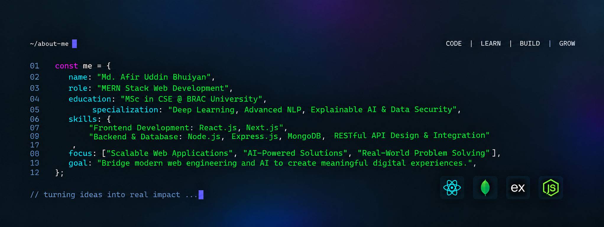

  

 
<h1 align="center">
  Hello , This is Md Afir Uddin Bhuiyan.
</h1>

  

---

## 👨‍💻 About Me

CSE graduate from MIST, currently pursuing an MSc in CSE at BRAC University. MERN Stack Developer specializing in building modern, scalable, and responsive web applications using React.js, Node.js, Express.js, and MongoDB, with proficiency in JavaScript, TypeScript, Next.js, and RESTful APIs. Combines strong problem-solving skills with a product-oriented mindset to develop efficient, maintainable, and user-focused software solutions that deliver business value.

---

## 🚀 Updates

- 🖥️ Currently working with **JavaScript, TypeScript, React.js, Next.js, Tailwind CSS, Shadcn/UI, HeroUI, DaisyUI, RESTful API Design & Integration** for frontend development and **Node.js, Express.js, MongoDB, BetterAuth, JWT** for Authentication, database management, and backend integration.
- 🗄️ Currently Exploring and Learning **Mongoose, PostgreSQL, and Prisma** for backend development.
- 🛠️ Currently pursuing **an MSc in CSE at BRAC University, exploring Deep Learning, Advanced NLP, Explainable AI & Data Security, and working on AI-driven solutions for real-world healthcare problems**.
- 📚 Continuously learning through **hands-on projects, problem-solving, and practical development**.
- 💡 Ask me about **JavaScript, TypeScript, React.js, and Next.js for Frontend Development; Node.js, Express.js, and MongoDB for Backend Development; and Git & GitHub for Version Control**.
- 🤖 Exploring **Al in Healthcare based research** and real-world AI applications.
- 🌐 Explore My [Resume](https://drive.google.com/file/d/1a-1G6Yk0aPaEZjh0QBXEpnDwOth97Gws/view?usp=sharing)

 

  

---
## 📫 Connect with Me

  

  

  

  

---

## 🛠️ Tech Stack

<h3>Programming Languages</h3>

  
  
  

<h3>Frontend Development</h3>

  
  
  
  
  
  
  
  

<h3>Backend & Database</h3>

  
  
  
  

<h3>Authentication & Tools</h3>

  
  
  
  
  
  
  
  
  
  

---

## 📊 GITHUB STATISTICS & ANALYSIS

<h3>GitHub Contributions:</h3>

  <picture>
    <source
      media="(prefers-color-scheme: dark)"
      srcset="https://raw.githubusercontent.com/mehsam1999/mehsam1999/output/github-contribution-grid-snake-dark.svg"
    >
    <source
      media="(prefers-color-scheme: light)"
      srcset="https://raw.githubusercontent.com/mehsam1999/mehsam1999/output/github-contribution-grid-snake.svg"
    >
    
  </picture>

### GitHub Statistics:

<table width="100%">
  <tr>
    <td width="50%" align="center">
      
    </td>
    <td width="50%" align="center">
      
    </td>
  </tr>
</table>

<h3>Repository Stats & Streak:</h3>

  

 

